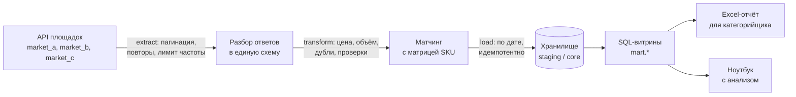
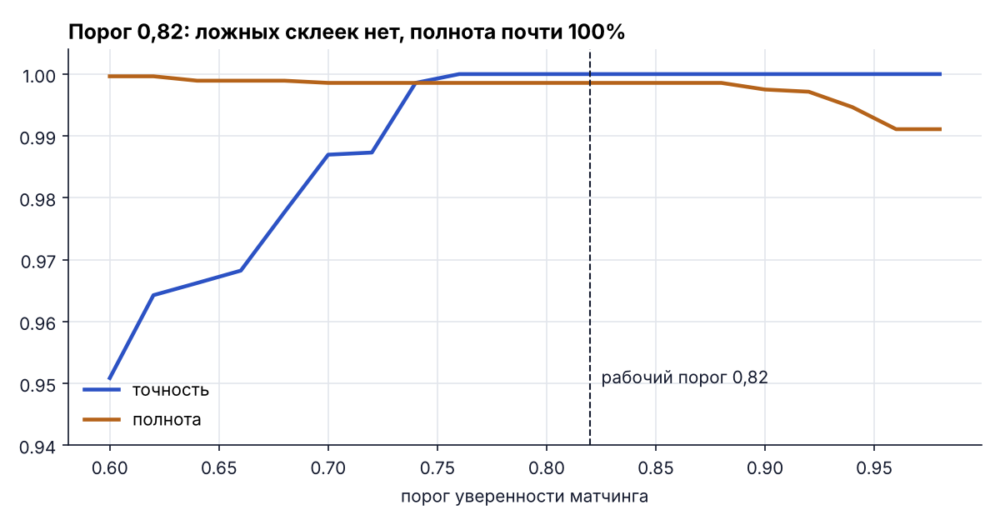
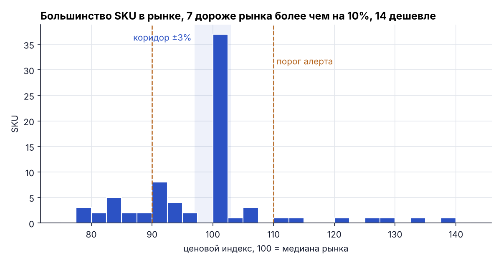
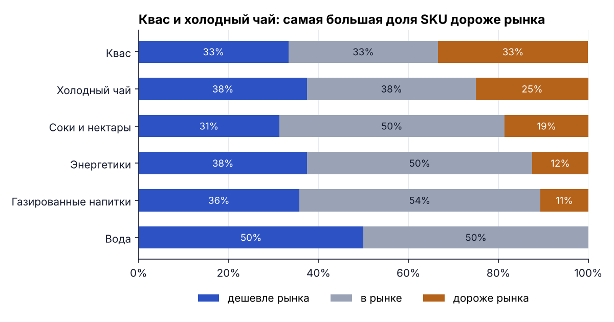
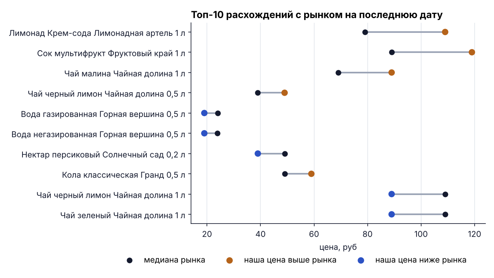
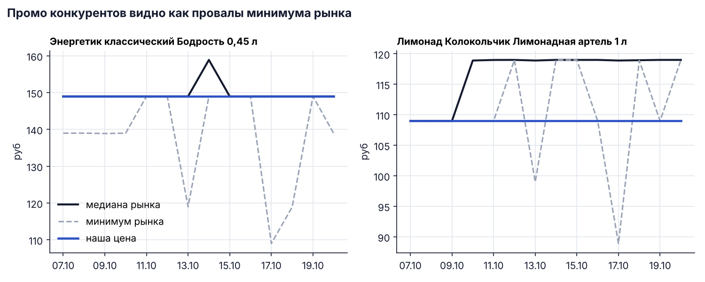

# Мониторинг цен конкурентов: ETL-пайплайн

*ETL pipeline that collects competitor offers from marketplace APIs, matches them to the retailer's own SKUs, loads them into a SQL warehouse and produces daily price-positioning marts and an Excel report.*

## Бизнес-задача

Категорийному менеджеру нужно каждый день знать, где наша цена выше или ниже рынка, и что с ней сделать. Вручную это часы: открыть карточки на площадках, найти те же товары, свести цены в таблицу, посчитать отклонения. Пайплайн делает это автоматически и выдаёт:

* ценовой индекс по каждому SKU и категории (100 = медиана рынка);
* список алертов, где отклонение больше 10%, с рекомендованной ценой, которая не опускает маржу ниже 25%;
* Excel-отчёт в привычном формате, готовый к работе.

## Архитектура



## Источники и данные

Клиент `MarketplaceClient` написан для настоящего REST API: таймауты, токен из переменной окружения, повторы с экспоненциальной паузой при 429 и 5xx, ограничение частоты запросов, три вида пагинации (по номеру страницы, курсору и смещению). Реальные площадки подключаются в `config.yaml` и запускаются с `--mode live`.

Демо работает офлайн: встроенный имитатор отдаёт ответы трёх площадок в тех же форматах. Данные специально «грязные», как в жизни:

| Площадка | Формат ответа | Особенности |
|---|---|---|
| market_a | `items[]`, страницы | цена строкой: `1 299 руб`, `88,90 руб`; второй продавец того же товара; лишние слова в названии |
| market_b | `data.products[]`, курсор | цена в копейках, сокращения `класс.`, `негаз.`, объём в мл, опечатки, пропуски цены |
| market_c | `offers[]`, смещение | бренд не указан в 25% позиций, бренд латиницей, мультипаки `6х0,5л`, дубли на соседних страницах |

На всех площадках есть товары, которых нет в нашей матрице: чужие бренды, новые вкусы, другие объёмы, «Тархун Zero» рядом с обычным «Тархуном». Собственная матрица: 76 SKU напитков (`data/own_catalog.csv`, структура выгрузки из 1С). Все данные синтетические.

## Как устроен матчинг

1. Объём и количество в упаковке разбираются из названия: `0,5 л`, `500 мл`, `6х0,5л`.
2. Бренд берётся из поля площадки, а если поля нет, ищется в названии по словарю наших брендов. Латинские написания (`Grand`) приводятся к нашим через словарь в `config.yaml`.
3. Бренд есть, но его нет в нашей матрице: позиция сразу отсеивается.
4. Кандидаты: SKU того же бренда и объёма. Сходство названий считается `rapidfuzz.token_sort_ratio` после нормализации (регистр, сокращения, тара, объём).
5. Маркер варианта (zero, лайт, прямого отжима), которого нет у кандидата, снижает сходство в 0,8 раза.
6. Порог 0,82, для позиций без бренда 0,90. Уверенность и способ сопоставления сохраняются в `core.offer_matches`.

Качество проверено на разметке имитатора (пайплайн её не видит), 14 дней, 3 372 предложения:

| Вариант | Точность | Полнота | Ложные склейки | Пропуски |
|---|---|---|---|---|
| Нечёткое сравнение названий | 98,1% | 98,2% | 54 | 50 |
| + словарь брендов и маркеры вариантов | **100%** | **99,9%** | **0** | 4 |

Оставшиеся 4 пропуска: опечатки внутри сокращений («нгеаз.»). Понижать ради них порог невыгодно, растут ложные склейки.



## Витрины

SQL в `sql/marts/` написан на общем подмножестве, которое работает и в PostgreSQL, и в DuckDB. Параметры ценовой политики лежат в таблице `core.pricing_params` и заполняются из `config.yaml`.

| Витрина | Что внутри |
|---|---|
| `mart.market_prices` | рынок по SKU и дате: минимум, медиана, максимум лучших штучных предложений в наличии |
| `mart.price_index` | наша цена к медиане рынка и позиционирование: дешевле / в рынке (±3%) / дороже |
| `mart.category_index` | медианный индекс категории и доли SKU по позиционированию |
| `mart.price_alerts` | отклонение больше 10%, рекомендованная цена с защитой минимальной маржи |
| `mart.price_history` | динамика нашей цены и рынка по дням |

Мультипаки в рыночную цену не попадают: за штуку они дешевле и исказили бы сравнение с полочной ценой.

## Результаты

Прогон за 14 дней (с 7 по 20 октября 2026): 3 472 позиции с трёх площадок, 56 дублей и 44 позиции без цены отсеяны, 2 802 предложения сопоставлены с матрицей. Из 149 запросов 9 повторены после временных ошибок 503, данные не потеряны.

**Время.** Один день, от запросов к API до готового Excel, занимает около 0,5 с внутри пайплайна и 1,4 с вместе с запуском Python. Загрузка истории за 14 дней: 7,4 с. Цифры для демо-набора; в реальном режиме основное время уйдёт на паузы между запросами к площадкам.

**Позиционирование на 20.10.2026** (76 SKU): 37 в рынке, 28 дешевле рынка, 11 дороже.





**Алерты: 21 SKU.**

* 14 SKU дешевле рынка больше чем на 10%: цену можно поднять в среднем на 16,6% и остаться не дороже медианы.
* 7 SKU дороже рынка. У 6 из них снижение до медианы упирается в минимальную маржу 25%, а 4 нельзя снизить вовсе. Это вопрос к закупочной цене, а не к рознице.





**Excel-отчёт** (`reports/price_monitoring_2026-10-20.xlsx`): листы «Алерты», «Индекс по SKU», «Категории», «Загрузка». Calibri 10, строка итогов над шапкой с автофильтром (итоги считаются через промежуточные итоги и пересчитываются при фильтрации), без заливок. Рекомендованная цена округлена до десятков и не нарушает минимальную маржу.

## Что это даёт бизнесу

* Ежедневная картина цен вместо ручного сбора: отчёт готов к началу рабочего дня.
* Решения по цене с аргументом: «мы дороже медианы трёх площадок на 20%», а не «кажется, дорого».
* Деньги на столе: SKU, где мы заметно дешевле рынка, можно поднять без потери конкурентности.
* Сигнал для закупки: позиции, где рынок продаёт ниже нашей цены с минимальной маржой, требуют переговоров с поставщиком.

## Структура

```
price-monitoring-etl/
├── config.yaml                 # источники, пороги матчинга, ценовая политика
├── data/own_catalog.csv        # своя матрица (структура выгрузки из 1С)
├── src/
│   ├── extract/                # клиент API и имитатор площадок
│   ├── transform/              # разбор полей, проверки, дедупликация, матчинг
│   ├── load/                   # загрузка в хранилище и пересборка витрин
│   ├── report.py               # Excel-отчёт
│   ├── evaluate.py             # оценка матчинга на разметке
│   └── pipeline.py             # оркестрация и CLI
├── sql/
│   ├── schema_postgres.sql     # схема для PostgreSQL
│   ├── schema_duckdb.sql       # та же схема для локального запуска
│   └── marts/                  # витрины
├── notebooks/01_price_positioning.ipynb
├── reports/                    # пример отчёта и графики
├── scripts/make_catalog.py     # генерация демо-матрицы
└── tests/                      # pytest: разбор, матчинг, клиент, идемпотентность
```

## Как запустить

```bash
python -m venv .venv && source .venv/bin/activate
pip install -r requirements.txt

# один день: данные, витрины и Excel-отчёт
python -m src.pipeline --date 2026-10-20

# история за две недели (отчёт строится за последний день)
python -m src.pipeline --start 2026-10-07 --end 2026-10-20

# тесты
pytest -q

# анализ
jupyter nbconvert --to notebook --execute notebooks/01_price_positioning.ipynb
```

Повторный запуск за ту же дату перезаписывает её данные одной транзакцией, дублей не появляется. Логи пишутся в `logs/pipeline.log`.

Для PostgreSQL: создать схему из `sql/schema_postgres.sql` и выполнить файлы `sql/marts/` по порядку.

## Стек

Python (requests, pandas, rapidfuzz), SQL (DuckDB локально, PostgreSQL в схеме), openpyxl, matplotlib, pytest.
